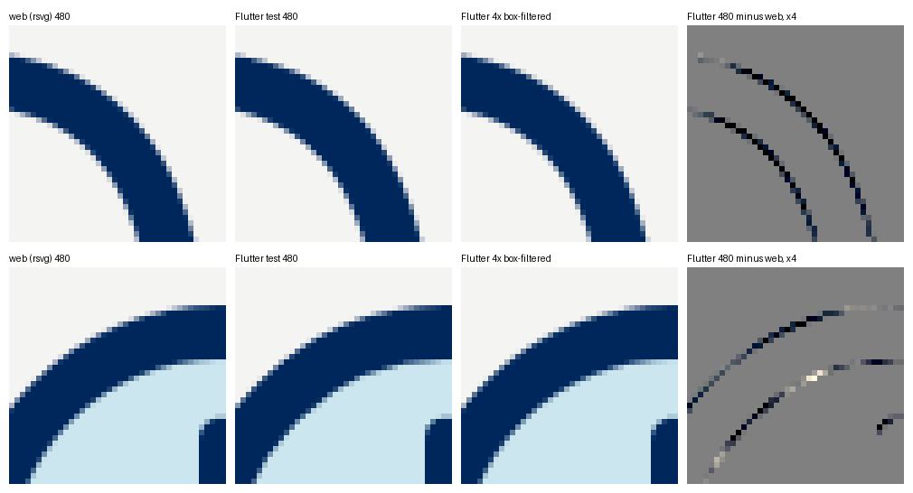

# The Flutter player

`packages/flutter` is the Dart package `onstage_mascot` (the name comes from `mascot.config.json`).
It is a dumb player for `spec/`, written to [`renderer-contract.md`](renderer-contract.md): it
samples baked frames and draws rects, ellipses, circles and paths. No springs, easing or motion
logic live in it. Dependencies: the Flutter SDK only.

Requirements: Dart `>=3.8.0 <4.0.0` (the same range as the OnStage platform's Flutter app) and
Flutter 3.41 or later (it uses `TickerMode.valuesOf`). Developed and tested on Flutter 3.47.4.

## Using it in an app

```yaml
dependencies:
  onstage_mascot:
    git:
      url: git@github.com:OnStageApp/onstage-mascot.git
      ref: v0.1.0          # a release tag; both packages share it
      path: packages/flutter
```

```dart
import 'package:onstage_mascot/mascot.dart';

Buddy(
  state: 'no-events',
  size: 160,
  onDone: () => setState(() => showCta = true),
)
```

The library file is `mascot.dart`, not `onstage_mascot.dart`, so renaming the package with
`tools/rename.mjs` only changes the package name in imports and never needs a file rename.

`Buddy` props, the same as the web component:

| prop | default | |
|---|---|---|
| `state` | required | A key from `spec/states.json`, for example `hello`. |
| `surface` | `MascotSurface.light` | `dark` hides the ground shadow. |
| `size` | 160 | Width and height in logical pixels. |
| `playOnMount` | true | Play the state's motion on mount and on every `state` change; false starts in idle. |
| `onDone` | null | Called when a once-motion finishes (also, right away, under reduced motion). |
| `reducedMotion` | null | null follows `MediaQuery.disableAnimations`; true shows the rest pose only. |
| `label` | state name | Semantics label; `''` hides it from assistive technology. |
| `random` | `Random().nextDouble` | Blink random source; pass `mulberry32(seed)` for reproducible blinks. |

It plays the state's motion once, then idles with random blinks (loop states loop). A `Ticker`
drives it; the ticker stops in the rest phase, under reduced motion, while the app lifecycle is not
`resumed` and while `TickerMode` is off, and the first tick after a pause advances by 0. Each frame
repaints only the `CustomPaint` (inside a `RepaintBoundary`) through a listenable; no widget
rebuilds per frame.

Without the widget:

```dart
// Pure: the poses of a state at a time (no widgets, no clock).
final frame = computeFrame('hello', phase: MascotPhase.motion, t: 1.2);
// Draw it.
CustomPaint(painter: MascotPainter.frame(frame, background: 'card'));
paintMascotFrame(canvas, size, frame, surface: MascotSurface.dark);
final image = await renderMascotImage(frame, 480, background: 'card');
// The headless player (phases, blinks), driven by hand, as in the tests.
final player = MascotPlayer(state: 'hello', random: mulberry32(7))..advance(1 / 60);
```

## Static usage

`Buddy` plays the state's motion and idles with blinks. When animation is unwanted or heavy (empty
states, long lists, screens that must stay still), use `BuddyStatic`: it draws the **resting pose** of a
state, once. It is a stateless `CustomPaint` widget with no `Ticker`, no `AnimationController` and no
timers, and it paints with the same `paintMascotFrame` as `Buddy` on the state's rest poses, so it draws
exactly the pose `Buddy` starts from (a test compares the pixels, for all 85 states on both surfaces).

```dart
import 'package:onstage_mascot/static.dart';

const BuddyStatic(state: 'no-events', size: 160)
BuddyStatic(state: 'hello', surface: MascotSurface.dark, semanticLabel: 'Welcome')
```

| prop | default | |
|---|---|---|
| `state` | required | A key from `spec/states.json`, for example `no-events`. |
| `surface` | `MascotSurface.light` | `dark` hides the ground shadow. |
| `size` | 160 | Width and height in logical pixels. |
| `semanticLabel` | state name | Semantics label; `''` hides it from assistive technology. |
| `excludeFromSemantics` | false | Leave it out of the semantics tree (purely decorative). |

`package:onstage_mascot/static.dart` imports only the states data (`states_data.g.dart`), never the
player, the sampler, the random source or the baked clips (`motion_data.g.dart`), and
`test/static_test.dart` checks that import graph. It also exports `MascotSurface`, `mascotStateKeys`
and `mascotStateInfo` (key, group, name and use note of every state). Both libraries can be imported
together. An app that imports only `static.dart` never references the motion data, so a release build
has no reason to carry it (the unreferenced constants are left out by tree shaking; not measured here).

Accessibility: `BuddyStatic` is a picture, so it wraps itself in `Semantics(image: true)` with the
state's name as the label (for example "No events yet"). Change the words with `semanticLabel`; if the
text next to it already says everything, use `excludeFromSemantics: true`.

For files rather than a widget (emails, marketing, stickers), see `assets/` and `npm run export-static`
in the root README.

## The data: generated Dart files, not an asset copy

Two generated files hold the text of every `spec/` file, verbatim, in raw string constants:
`lib/src/states_data.g.dart` (`palette.json` and `states.json`) and `lib/src/motion_data.g.dart`
(`motion/*.json`). They are separate so the static library imports the first and not the second.
`MascotStates.instance` parses the palette and states on first use; `MascotSpec.instance` (which
extends `MascotStates` and shares the same parsed states) adds the clips, each parsed the first
time it is needed. This was chosen over copying `spec/` into the package as assets because:

- a Flutter package cannot declare assets outside its own folder, so assets would need a copied
  folder anyway;
- a source file gives the data synchronously: no asset bundle, no async first frame, and plain unit
  tests work without a binding;
- it mirrors the web package, which embeds `spec/` in `src/spec-data.ts` (everything) and
  `src/static-data.ts` (states only).

After any change to `spec/` (after `npm run bake`), regenerate it in `packages/flutter`:

```sh
dart run tool/gen_spec_data.dart
```

`test/spec_drift_test.dart` regenerates both in memory and fails if a checked-in file differs from
`spec/`, so a forgotten regeneration cannot ship. The generated files are about 125 KB (states) and
100 KB (motion) of source.

## Tests

In `packages/flutter` (Flutter at `/Users/vinterantonio/fvm/default/bin` on the reference Mac):

```sh
flutter test              # all unit, widget and render tests
flutter analyze           # zero issues expected
dart format .
(cd example && flutter test)
```

| test | checks |
|---|---|
| `rng_test.dart` | mulberry32 check values for seed 7 from the contract, 32-bit masking, `imul32` |
| `sampler_test.dart` | `locate` (once and loop with intro), linear interpolation, tilt never wrapped, `mixDiscrete`, additive and absolute combining, offsets, blink factor |
| `player_trace_test.dart` | the player against a trace recorded from the web player: same `random()` calls on the same frames, same phases and clock, same eye heights, under steady and irregular dt (zero, dropped and clamped frames), for one, two and three actors |
| `spec_drift_test.dart` | the generated data equals `spec/`; every state's clip exists |
| `names_test.dart` | package and widget names equal `mascot.config.json` |
| `buddy_test.dart` | motion then `onDone` then idle, reduced motion, the prop overriding `MediaQuery`, lifecycle pause, semantics, every state painting on both surfaces |
| `static_test.dart` | `static.dart`'s import graph (no player, sampler, rng or motion data, no Ticker or Timer in what it loads), `BuddyStatic` builds all 85 states on both surfaces, schedules no frames, paints the same pixels as the frame painter and as `Buddy` at rest, and its semantics |
| `parity_render_test.dart` | renders the parity PNGs (below) |
| `parity_static_test.dart` | renders the static parity PNGs with `BuddyStatic` (below) |

The web trace lives in `test/fixtures/web_player_trace.json`. Regenerate it from the repo root
after changing `spec/` or the web player: `npm run build && node packages/flutter/tool/web-trace.mjs`.

## Parity

From the repo root:

```sh
packages/flutter/tool/parity.sh            # the 130 manifest cases, then the 170 static cases
EXTRA=1 packages/flutter/tool/parity.sh    # plus 260 extra cases
STATIC=1 packages/flutter/tool/parity.sh   # the static cases only
```

It runs `npm run parity:web` (web frames and `tests/parity/manifest.json`), then
`flutter test test/parity_render_test.dart`, which paints every case at 480 px on the `card`
colour with `PictureRecorder` and `toImage` inside `tester.runAsync`, using the same file names as
the web harness, into:

- `tests/parity/out/flutter/`: painted straight at 480 px;
- `tests/parity/out/flutter/ss4/`: painted at 1920 px and box-filtered (4 by 4 average) to 480 px.

Then it runs `tests/parity/compare.py` on both, with reports in
`tests/parity/out/flutter/report/` and `ss4-report/` (the straight run also writes a
`<case>-diff.png` per case: difference times 4, grey where equal). With `EXTRA=1`,
`tool/extra-parity-web.mjs` adds every crossfade frame of every clip (whole and half frames), the
idle phase at odd times for one to four actors, the additive `pop` clip, the loop clip across its
wrap, explicit blink factors on `oval`, `big` and `small` eyes, and the dark surface, under
`tests/parity/out/flutter/extra/`.

### Results (2026-10-08, Flutter 3.47.4, rsvg-convert from Homebrew)

| comparison | cases | failing | max | mean of means | worst mean | worst pixel share over 32 | tolerance |
|---|---|---|---|---|---|---|---|
| manifest, 4x box-filtered | 130 | 0 | 42 | 0.0138 | 0.0274 | 0.0009% | defaults (max 48, mean 0.5, 1%) |
| manifest, straight 480 px | 130 | 0 | 88 | 0.0478 | 0.0991 | 0.073% | max 112, mean 0.5, 1% |
| extra, 4x box-filtered | 260 | 0 | 42 | 0.0211 | 0.0388 | 0.0009% | defaults |
| extra, straight 480 px | 260 | 0 | 88 | 0.0583 | 0.1030 | 0.073% | max 112, mean 0.5, 1% |

Closest to the tolerance: `rest-73-swap` in the 4x set (max 42 of 48), a navy cubic stroke with
round caps. At the default `--tol-max 48` the straight set fails 68 of 130 cases, every one on max
alone (worst mean 0.099 against 0.5, worst pixel share 0.073% against 1%).

### Static mode

`npm run parity:web:static` renders the resting pose of all 85 states on both surfaces with the web
static entry (`renderRestSvg`, rasterised by `rsvg-convert` on the `card` colour) and writes
`tests/parity/manifest-static.json` (170 cases: 85 light, 85 dark). `test/parity_static_test.dart` renders the
same cases with the `BuddyStatic` widget, a `ColoredBox` of the card colour behind it (the widget is
transparent, so the comparison also covers that), straight at 480 px and captured at pixel ratio 4 then
box-filtered, into `tests/parity/out/flutter-static/` and `flutter-static/ss4/`. `compare.py` then applies the
same rules as the animated parity: the defaults at 4x, and the straight run with only `--tol-max` raised to 112.

| comparison | cases | failing | max | mean of means | worst mean | worst pixel share over 32 | tolerance |
|---|---|---|---|---|---|---|---|
| static, 4x box-filtered | 170 | 0 | 42 | 0.0118 | 0.0274 | 0.0009% | defaults (max 48, mean 0.5, 1%) |
| static, straight 480 px | 170 | 0 | 88 | 0.0422 | 0.0958 | 0.073% | max 112, mean 0.5, 1% |

(2026-10-08, Flutter 3.47.4, rsvg-convert from Homebrew.) Light surface alone, the 85 states of the
brief: 4x max 42, mean of means 0.0131; straight max 88, mean of means 0.0460, worst mean 0.0958. At the default
`--tol-max 48` the straight run fails 78 of 170 cases (39 of the 85 light ones), every one on max alone, the same
anti-aliasing floor described below. The worst case is again `rest-73-swap`.

### Why two comparisons, and why max 112 for the straight one

The straight differences are anti-aliasing, not geometry:

1. **The test rasteriser is coarser than rsvg.** Against exact coverage (computed analytically at
   16 by 16 samples per pixel) on a filled disc and a stroked ring, Flutter's test rasteriser (Skia
   on the CPU, inside `flutter_tester`) is off by up to 0.22 to 0.34 of a pixel's coverage on an
   edge pixel; `rsvg-convert` by at most 0.095. On navy against `card` (a 244 step in red) that is
   up to about 83 versus 23.
2. **The floor on identical geometry is 105.** `packages/flutter/tool/aa_floor/run.sh` paints 40
   scenes of plain circles, stroked rings, ellipses, rotated rounded rects and round-capped
   quadratic strokes with both rasterisers. Geometry is identical by construction, yet every scene
   fails the default max: max 105, worst mean 0.13, worst pixel share 0.15%. The mascot's worst
   case (88) sits below that floor.
3. **Averaging out the coarse anti-aliasing removes the gap.** Painted at 4x and box-filtered, the
   Flutter frames pass every case at the default tolerances (max 42), while the Flutter 480 px
   frames differ from their own 4x versions by up to 95, and the web 480 px frames from theirs by
   at most 31. The two 4x versions agree within 22.

So the 4x comparison at the unchanged defaults is the geometry check (draw order, shapes,
colours, crossfades, timing), and the straight comparison only raises `--tol-max`, to 112: the
measured floor of 105 plus a small margin. Mean and pixel share keep their defaults, so a real
geometry error still fails it (a half pixel shift of a navy edge already gives about 122).
`renderer-contract.md` section 11 now says this (see its Changes list).



`packages/flutter/doc/parity-aa-evidence.png`: the worst two cases (`rest-73-swap`, a stroked
cubic; `rest-27-session-expired`, a stroked circle) cropped and enlarged. The difference image
shows single pixel lines along edges only, with nothing in the interiors.

### On a device

Phones render with Impeller (4x MSAA) or Skia on the GPU, not with the test rasteriser, so edge
pixels will differ from both again. Geometry, colours and timing are what the tests pin down; edge
anti-aliasing is the rasteriser's.

## Extra clips (0.3.0)

The data carries the additive extra clips (`hop`, `glance-left`, `glance-right`, `look-around`) and the
painter and `applySample` honour the `shadow` factor (contract sections 4.1 and 8), so a clip sampled and
applied by hand draws like the web. `MascotPlayer` has no `playClip` or ambient schedule yet (contract 9.6);
porting it is the next step for the platform.

## Notes for adopters

- Class names that would clash with Flutter carry a `Mascot` prefix (`MascotLayer`, `MascotClip`,
  `MascotPose`, `MascotActor`), so `material.dart` and this package import together.
- `Buddy` restarts its motion when `state` or `playOnMount` changes (as the web component does);
  changing `surface`, `size` or `reducedMotion` does not restart it. To replay the same state, give
  it a new `key`.
- Flutter's `RRect` scales all corner radii together when they do not fit, while SVG clamps `rx`
  and `ry` separately. The spec stores rect radii already clamped (contract section 5), and every
  character rect fits, so the two agree; keep radii clamped if you add props.
- Strokes with no join given use miter with limit 4, as SVG does.
